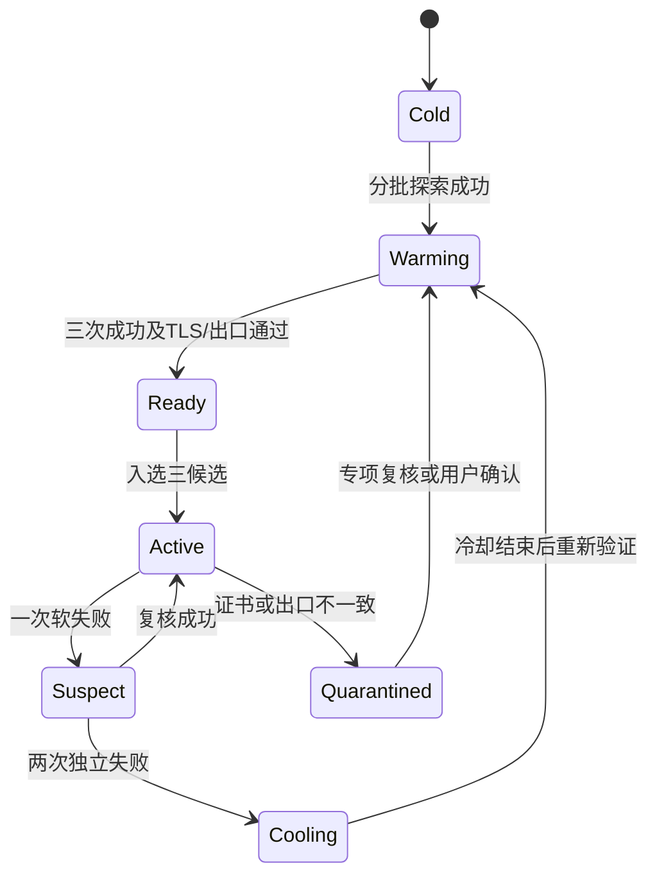

# 稳定优先规格

本文中的参数是首版实验默认值，不是已验证的手机性能结论。算法参考模型位于 `reference/stability_pro/engine.py`；真正后台运行和网络检测待移植到 Go / Android。

## 1. 路由身份与出口隔离

一个候选 = 具体机场中继 + HTTP/SOCKS5 住宅协议 + 固定住宅终端。名称建议 `IP1-兔兔云-017-HTTP`，同一中继 S5 另建候选。中继与住宅总延迟才是选优输入；不能把机场单段延迟与完整链路延迟相加近似。

`exitKey` 从住宅端点、认证标识的本地带盐 HMAC、预期公网出口及组 ID 生成，不能只看别名 IP1。同一组必须具有一致 exitKey；解析阶段拒绝混组、循环、自引用、DIRECT 或仅机场候选。代理认证原文永不进入日志或哈希清单。

所有 `dialer-proxy` 保持具体 `RF2-Relay-*`。不串到通用“自动选择”，避免机场随机变化破坏住宅可达性。切候选是切完整链路。新增账号/出口由用户明确绑定，算法无权跨出口切换。

## 2. 分层池

| 层级 | 数量 | 作用 |
| --- | --- | --- |
| 全量池 | 导入后的全部候选 | 保留配置，只低频轮换探索；不因一次失败删除 |
| 候补池 | 建议 6–12 | 多次验证，按当前网络分别记录稳定性 |
| 在线池 | 最多 3 | 主用 + 备用一 + 备用二，高频小规模检测 |

晋升至少 3 次成功，间隔总跨度至少 10 秒，至少一次目标域名 TLS 验证正常，且近期真实出口与预期一致。初次出口未知时不能宣称已验证固定出口。候选数不足可降级为 1–2 条，不能偷偷加不合格线路。

先按可靠性置信下界筛选，处于最高分 0.03 范围内才比较 P95 / EWMA 延迟；用 64 个最近成功延迟样本、EWMA α=0.2、24 小时可靠性半衰期。参考实现采用 Wilson 下界近似，不是完整贝叶斯后验。生产版需用 Go 单元测试钉住排序、衰减和边界，避免宣传为机器学习。

在线池尽量分散到不同中继、不同机场；HTTP/S5 通过同一个中继是相关故障，不能算三条独立备用。优先多样性不能覆盖资格门槛。手机网络变化后重新验证，电脑测速成绩只能作为探索排序的弱提示。

## 3. 检测预算与耗电

默认主用每 10 秒、两个备用各每 20 秒，错开启动：正常约 720 次轻量检测/小时。每分钟最多探索一条约 60 次/小时；TLS 专项和出口核验额外消耗预算。**总预算首版上限 900 次/小时/出口组**，包含复核与探测，故障事件优先使用保留预算，不能无限重试。

最多 2 个探测并发；冷池不与故障处理争用槽位。常规验证优先小响应的 HTTPS 请求，不下载页面大资源、不发 ICMP 作为住宅链路合格判据、不同时请求 7 个 IP 查询服务。失败后才用第二测试服务交叉确认。目标 TLS 每个活跃候选约 10 分钟一次，出口约 30 分钟一次及网络/配置改变后一次，故障期间禁止全量并发出口查询。

探测超时 2500 ms 初值；连续故障时按情况调整，不能把稳定的 3 秒跨境链路永久判为恶意。拨号自适应超时可从 `clamp(近期建立时延 P95×3, 800ms, 2500ms)` 试起，只是工程起点，必须记录并实测。整体调用 deadline 控制最多三次候选尝试的总时长，不允许每次重置上游 context。

锁屏运行依靠已有前台 VPN 服务；不得通过长时间 wakelock 保证精确 10 秒。Doze/系统暂停可推迟检测，UI 显示真实年龄。恢复时旧结果失效，先验证当前/备用；流量恢复之前不使用过期备用。提供“省电”档（30/60秒）和默认稳定档，不能把实际延迟检测频率伪装为恒定实时。

管理组禁用旧全池后台 URLTest，避免预算叠加；非管理组完全维持原设置。

## 4. 状态与快速切换

新连接建立失败时可立即尝试近期正常备用，不等所有节点测速。原主用先标可疑，备用升为主用；软失败需两次独立样本才能长冷却（重复事件 3 秒去重）。证书验证失败、出口不一致立即隔离，不忽略错误继续发账号流量。

冷却从 60 秒开始，重复失败翻倍，最高 30 分钟。成功一次不能立刻抢回主用；重新多次验证后进候补。健康主用保持，不因候补稍快自动跳。用户手动固定线路时仍显示故障和建议，尊重暂停自动选择选项。

备用合格要求：最后成功不超过 30 秒、最后结果不是失败、TLS/出口专项年龄不过期、当前网络/配置代一致、不处于冷却。一个软失败后即时退出可用池，复核成功才恢复。

若所有候选同时失败，区分：本地网络离线、共同住宅终端失败、同一测试服务故障、目标站故障。显示“无可用住宅链路”，维持固定出口边界，不擅自出机场 IP。无须强制发 DIRECT 测试请求；网络验证使用 Android 已验证网络状态和用户授权的隔离诊断。

## 5. 无感边界

同次 DialContext 可在尚未交付应用连接前换候选。若 HTTP CONNECT / S5 懒握手发生在 FirstWrite，必须在代理控制握手阶段解决，不能把含应用 payload 的任意 Write 当作可重放。内核不能替 ChatGPT 解密 TLS，无法直接获知 ChatGPT 的证书固定策略或 SSL 错误。

已建立连接中断无法搬移到另一 TCP；只对后续重连选健康路径。业务已发字节、流式输出、QUIC、WebSocket 等有独立生命周期。默认不关闭所有连接；显示重连提示并记录剩余旧线路连接数。参考模型对 `payload_sent=true` 拒绝透明重试。

## 6. UI 与持久化

首页只增加稳定模式开关、当前完整链路、最近检测时间和状态。“详情”呈现三个候选及延迟/成功率/冷却。“测试”更新检测记录，不修改实际选择；后台调度事件另列切换原因。导出诊断入口与故障时间标记一键操作，用户看到文件体积和覆盖时间。

持久化统计上限 2 MiB：每组每网络的有界窗口与聚合，网络最多 8 个 LRU，节点最多导入上限（建议 512），不用每次探测永久写 SQLite。重启保留统计但将活跃资格标为待复核，避免凭几天前的结果发新连接。
